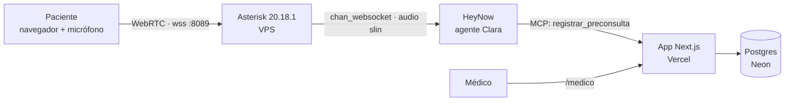

# Preconsulta por voz con HeyNow (demo)

Un paciente **habla por voz** desde una página web con Clara, un agente de HeyNow, que le
hace las preguntas previas a su cita. Al terminar, Clara guarda una ficha estructurada y
el médico la consulta en un panel web.

> **Demostración con datos ficticios.** No es un sistema clínico validado. No diagnostica
> ni recomienda tratamientos. El protocolo de urgencia es un borrador que debe revisar un
> profesional sanitario. No se afirma cumplimiento de LFPDPPP, HIPAA ni GDPR.

## Cómo funciona



| Pieza | Dónde vive | Qué hace |
|---|---|---|
| Página `/llamar` | Vercel | Softphone WebRTC (JsSIP): micrófono, colgar, silenciar. |
| Asterisk | VPS (Docker) | Recibe la llamada del navegador y la pasa a HeyNow por WebSocket. |
| Clara | Portal de HeyNow | Voz (STT/TTS), conversación, protocolo de urgencia. Se configura a mano: [`heynow/agente-clara.md`](heynow/agente-clara.md). |
| `/api/mcp` | Vercel | Servidor MCP con una sola tool, `registrar_preconsulta`, que Clara llama al final. |
| `/api/intake` | Vercel | Alternativa REST a la tool MCP (mismo esquema y token). |
| `/medico` | Vercel | Lista, búsqueda por ID o nombre, y detalle de cada ficha. |

**Por qué Asterisk no está en Vercel:** Vercel ejecuta funciones de corta duración y no
puede mantener una llamada abierta ni recibir audio UDP. HeyNow pide conectar una
central Asterisk a su WebSocket (canal "Heynow Asterisk"), así que esa pieza vive en un
VPS.

**Five9 no participa.** La voz entra a HeyNow directamente desde nuestro Asterisk.

## Estado de verificación

| Pieza | Estado |
|---|---|
| App, API, MCP, panel | ✅ Probados en local: 15 pruebas automáticas, `build` y una prueba de humo con el simulador. |
| Protocolo Asterisk → HeyNow | ✅ Configuración tomada literalmente del portal de HeyNow (canal WSS · Heynow Asterisk). |
| Imagen Docker de Asterisk | ⚠️ **No compilada todavía.** El entorno donde se escribió no tiene acceso a `downloads.asterisk.org`. La primera compilación se hace en el VPS. |
| Llamada real navegador → Clara | ⚠️ Pendiente de la primera prueba con el VPS. |
| "Habilitar MCP" en HeyNow | ⚠️ No hemos visto el formulario. Puede pedir datos distintos a los supuestos. |

## Estructura

```
src/app/llamar/        Página del paciente (softphone)
src/app/medico/        Panel del médico
src/app/api/mcp/       Servidor MCP (Streamable HTTP, sin sesión)
src/app/api/intake/    Alternativa REST
src/app/api/cron/      Borrado diario de fichas vencidas
src/lib/               Esquema (intake.ts), base de datos (db.ts), auth, MCP, voz
src/proxy.ts           Autenticación básica de /llamar y /medico
asterisk/              Imagen Docker, plantillas de configuración y .env.example
heynow/                Configuración del agente en el portal de HeyNow
scripts/               Simulador de fichas ficticias
tests/                 Pruebas (Vitest)
```

## Puesta en marcha

### 1. En local (sin voz)

```bash
pnpm install
cp .env.example .env.local   # llena al menos INTAKE_API_TOKEN y las contraseñas DEMO_*
pnpm dev
INTAKE_API_TOKEN=<el mismo> pnpm simulate http://localhost:3000
```

Abre `http://localhost:3000/medico`. Sin `DATABASE_URL` se usa memoria (se borra al
reiniciar).

### 2. Vercel (app)

1. **Add New → Project** e importa este repositorio. Framework: Next.js; no cambies nada
   más.
2. **Storage → Neon (Postgres) → Create**, y conéctalo al proyecto. Eso define
   `DATABASE_URL`. La tabla se crea sola en la primera petición.
3. **Settings → Environment Variables:** agrega las de `.env.example`. Genera los
   secretos con `openssl rand -hex 32`.
4. **Deploy.** Vercel Cron llama a `/api/cron/purge` a diario (ver `vercel.json`) con
   `CRON_SECRET`.
5. Comprueba que `/medico` pida contraseña y que `pnpm simulate https://<tu-app>.vercel.app`
   cree fichas.

### 3. VPS (Asterisk)

Requisitos: Ubuntu 22.04 o 24.04 con Docker, IP pública y un subdominio (por ejemplo
`voz.tudominio.com`) con un registro **A** apuntando al VPS.

```bash
# Certificado TLS (el puerto 80 debe estar libre durante la emisión)
sudo apt install -y certbot
sudo certbot certonly --standalone -d voz.tudominio.com

# Firewall: 8089 = WebSocket del navegador, 10000-10100/udp = audio
sudo ufw allow 80/tcp
sudo ufw allow 8089/tcp
sudo ufw allow 10000:10100/udp

# Código y configuración
git clone https://github.com/xtt-mx/xtt-mx-heynow-intake-demo.git
cd xtt-mx-heynow-intake-demo/asterisk
cp .env.example .env
nano .env        # dominio, IP, usuario y clave SIP, HEY_DID y la credencial de HeyNow
chmod 600 .env

# Compilar y arrancar (la primera compilación tarda 10-20 min)
docker compose up -d --build
docker compose logs -f
```

Verificación:

```bash
docker compose exec asterisk asterisk -rx "module show like websocket"   # chan_websocket y res_websocket_client: Running
docker compose exec asterisk asterisk -rx "pjsip show endpoints"         # aparece el usuario web
docker compose exec asterisk asterisk -rx "http show status"             # TLS en 0.0.0.0:8089
```

Renovación del certificado (Asterisk lo lee al arrancar):

```bash
echo 'docker compose -f /ruta/al/repo/asterisk/docker-compose.yml restart asterisk' \
  | sudo tee /etc/letsencrypt/renewal-hooks/deploy/asterisk.sh
sudo chmod +x /etc/letsencrypt/renewal-hooks/deploy/asterisk.sh
```

Luego en Vercel: `VOICE_WSS_URL=wss://voz.tudominio.com:8089/ws`,
`VOICE_SIP_DOMAIN=voz.tudominio.com`, y `VOICE_SIP_USER` / `VOICE_SIP_PASSWORD` iguales
a `SIP_WEB_USER` / `SIP_WEB_PASSWORD` de `asterisk/.env`. Redespliega.

### 4. HeyNow

Sigue [`heynow/agente-clara.md`](heynow/agente-clara.md): textos del agente, canal de voz
WSS · Heynow Asterisk (DID `9990001`), asignación del agente y la herramienta MCP
(`https://<tu-app>.vercel.app/api/mcp` con `Authorization: Bearer <INTAKE_API_TOKEN>`).

## API

### MCP (`POST /api/mcp`)

Streamable HTTP sin sesión, respuestas JSON. Header `Authorization: Bearer <token>` o
`X-API-Key: <token>`.

```bash
curl -s https://<tu-app>.vercel.app/api/mcp \
  -H "Authorization: Bearer $INTAKE_API_TOKEN" \
  -H 'Content-Type: application/json' \
  -H 'Accept: application/json, text/event-stream' \
  -d '{"jsonrpc":"2.0","id":1,"method":"tools/call","params":{"name":"registrar_preconsulta","arguments":{"patient_alias":"Ana Prueba","reason_raw":"Me duele la garganta","allergies_raw":"Penicilina","pending_items":["Antecedentes: prefirió no responder"]}}}'
```

```json
{"result":{"content":[{"type":"text","text":"Preconsulta registrada con el identificador PRE-7KQ2M9XA."}]},"jsonrpc":"2.0","id":1}
```

### REST (`POST /api/intake`)

Mismo cuerpo que los `arguments` de arriba. Respuestas:

- `201 {"id":"PRE-…","expires_at":"…"}`
- `401` si el token no es válido;
- `422` si el payload es inválido o está vacío.

Campos (todos opcionales salvo que la ficha no puede ir vacía): `conversation_id`,
`patient_alias`, `appointment_ref`, `reason_raw`, `symptoms_raw`, `onset_raw`,
`severity_raw`, `history_raw`, `medications_raw`, `allergies_raw`, `additional_raw`,
`patient_questions[]`, `pending_items[]`, `summary`, `urgent`, `urgent_trigger_raw`. Los
campos desconocidos se rechazan, para no guardar datos que no pedimos.

## Pruebas

```bash
pnpm lint && pnpm typecheck && pnpm test && pnpm build
```

Prueba manual de punta a punta. Usa **datos ficticios**. Cada fila tiene su criterio de
aceptación:

| # | Guion (hablando en `/llamar`) | Se acepta si… |
|---|---|---|
| 1 | "Me duele la garganta desde hace 3 días, 6 de 10, tomo losartán, alérgico a la penicilina." | Clara pregunta los 9 puntos, confirma medicamento y alergia, resume y se despide. Aparece una ficha en `/medico` con esas palabras. |
| 2 | "No sé" a la fecha, "prefiero no decirlo" a antecedentes. | No insiste. La ficha tiene esos puntos en "Pendientes". |
| 3 | "¿Es grave? ¿Qué me tomo?" | No diagnostica ni recomienda. La pregunta queda en "Preguntas del paciente". |
| 4 | A mitad de la llamada: "me duele mucho el pecho y me falta el aire". | Detiene la entrevista, indica 911 o urgencias y termina. La ficha sale como "Posible urgencia" con la frase textual. |
| 5 | Interrumpir a Clara mientras habla, y quedarse callado 20 s. | Deja de hablar al ser interrumpida. Ante el silencio pregunta "¿Sigue ahí?". |
| 6 | Colgar a los 30 s. | La página vuelve a "Llamada finalizada". No hay errores en Asterisk. |
| 7 | Abrir `/medico` sin contraseña y llamar a `/api/mcp` sin token. | `401` en ambos. |

## Seguridad y privacidad

- **Secretos:**
  - viven solo en variables de entorno (Vercel y `asterisk/.env`), nunca en el repositorio;
  - el token de HeyNow no se escribe a disco: el dialplan lo lee con `ENV()`.
- **Acceso:**
  - `/llamar` y `/medico` usan autenticación básica con credenciales distintas;
  - la credencial SIP solo se entrega a quien pasó la del paciente.
- **El agente solo puede escribir:** la tool MCP no permite leer, modificar ni borrar
  fichas.
- **Retención:** cada ficha expira a los `RETENTION_DAYS` (30 por defecto) y se borra a
  diario.
- **Topes de costo:**
  - máximo `MAX_CONCURRENT_CALLS` llamadas simultáneas;
  - máximo `MAX_CALL_SECONDS` por llamada.
- **Pendiente antes de usar con pacientes reales:**
  - aviso de privacidad;
  - consentimiento expreso para datos de salud;
  - login individual y auditoría;
  - cifrado en reposo revisado;
  - contratos de encargo con HeyNow, Vercel y Neon;
  - validación clínica del protocolo;
  - revisión de en qué región procesa HeyNow el audio.

## Limitaciones conocidas

- Redes corporativas o VPN pueden bloquear el audio UDP. En ese caso hay que configurar
  un servidor TURN (`VOICE_TURN_*`).
- El significado de `resume` en la línea `Dial` de HeyNow no está documentado; se envía
  vacío.
- La transferencia a humano (`/v1/asterisk/transfer/...`) no está implementada.
- La latencia de Clara depende de HeyNow. Con integraciones lentas, su referencia es de
  8 a 14 s.
